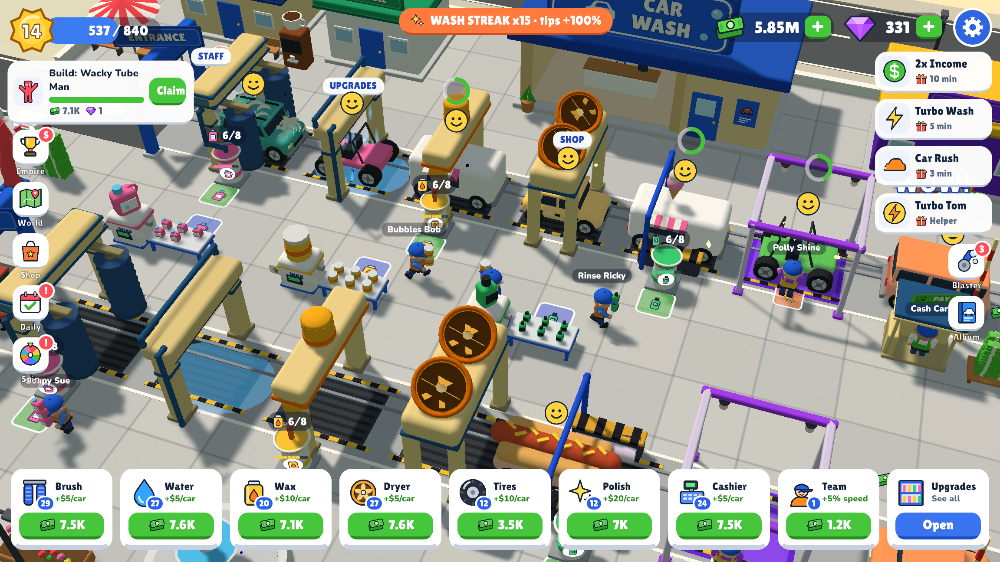

# Suds Tycoon

**Build a car-wash empire, from your hometown to Mars.** An idle-arcade tycoon game for Android, with a browser version.

## About

Start with one wash bay, hire staff, upgrade your machines and expand across a 17-city world tour.

- 17 cities in 6 regions, each with 32 build pads
- Machines that upgrade to level 30, plus staff and business upgrades
- Every city you leave keeps earning as a branch of your empire
- Daily rewards, lucky spin, car album, hats and golden cars
- Bubble Blaster mini-game
- Offline earnings and optional rewarded-ad boosts

## Built with

Unity 6.3 · C# · Universal Render Pipeline · UI Toolkit · New Input System · Android

The original browser prototype (HTML, CSS, JavaScript) is in `WebVersion/`.

## Run it

1. Open the folder in Unity Hub (Unity 6.3).
2. Menu **Tools > Suds Tycoon > Create Game Scene**.
3. Press **Play**. Drag to move, or use WASD.

Full design and code notes: [DESIGN.md](DESIGN.md)

## My role

Built with AI-assisted development. I designed the game and directed and tested it.
